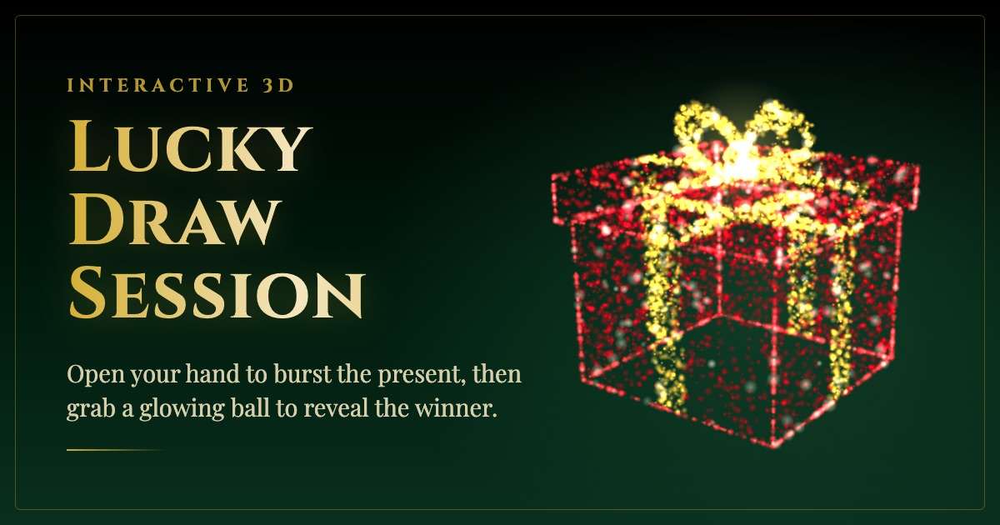

# 🎁 Lucky Draw Session

An interactive 3D lucky draw you control with your hands. Open your hand to burst a glowing particle present, then grab one of the orbiting lucky balls to reveal the winner.



## ✨ Features

- **Hand gesture control:** your webcam and MediaPipe hand tracking drive the whole draw, no mouse needed.
- **Particle present:** a red and gold present made of particles that bursts apart (CHAOS) and reassembles (FORMED).
- **Lucky balls:** 16 metallic balls orbit the scene on two rings. Each one holds a participant from the listing.
- **Winner reveal:** the picked ball explodes and shows the winner's photo and name on a polaroid card.
- **No repeat winners:** picked names are saved in `localStorage` and left out of later draws until you reset.
- **Picked list:** a panel you can collapse lists everyone drawn so far, with a **Reset** button to start over.
- **Look:** emerald and gold styling with bloom, vignette and noise post-processing.
- **Link previews:** Open Graph and Twitter card tags so shared links show the preview image above.

## 🛠️ Installation

1. **Clone the repository:**

   ```bash
   git clone <repository-url>
   cd lucky-draw
   ```

2. **Install dependencies.** This also downloads the MediaPipe hand model to `public/models/hand_landmarker.task`:

   ```bash
   npm install
   ```

3. **Run the development server:**

   ```bash
   npm run dev
   ```

4. **Open your browser:**
   - Go to `http://localhost:3010`
   - Allow camera access for gesture control

> If the hand model is missing, run `npm run download-model` (or `download-model.sh` / `download-model.bat`).

## 🎯 How to Run a Draw

1. **Stand in front of the webcam.** Your hand shows in the preview at the top right, and a gold pointer follows your index finger.
2. **Open your hand** (spread all fingers) to burst the present. The lucky balls fly in and orbit the scene.
3. **Swipe your palm sideways** to spin the orbit and bring different balls into reach.
4. **Point at a ball** to highlight it, then **make a fist (grab)** to pick it.
5. The ball explodes and the **winner's polaroid** appears.
6. **Point at the ✕ button and grab** (or click it) to close the card and draw the next winner.

### Gesture Reference

| Gesture | Action |
| --- | --- |
| Open hand | Burst the present (CHAOS mode) |
| Closed fist | Reassemble the present (FORMED mode) |
| Point with index finger | Move the pointer / highlight a ball |
| Grab | Pick the highlighted ball, or press the ✕ button |
| Swipe palm sideways | Spin the lucky ball orbit |

> Gestures only take effect about 5 seconds after the page loads, so the scene has time to settle.

### On-screen Controls

- **Picked list (top left):** expand it to see everyone drawn so far. **Reset** clears the record so every participant can be drawn again.
- **Credits (bottom right):** shows the developers.

## 👥 Adding Participants

Participants are listed in [`src/listing/sample.json`](src/listing/sample.json):

```json
[
  { "name": "sample 1", "imageUrl": "/photos/balls/sample/1.png" },
  { "name": "sample 2", "imageUrl": "/photos/balls/sample/2.png" }
]
```

To build the list from a folder of photos:

1. Put the photos in `public/photos/balls/sample/` (jpg, jpeg, png, gif, webp or bmp). Each file name, without the extension, becomes the participant's name.
2. Run the generator from the `src/scripts` folder:

   ```bash
   cd src/scripts && sh image-to-json.sh
   ```

   Options: `--folder <path>`, `--output <file>` and `--base-path <path>` (run with `--help` for details).

## 🚀 Build & Deploy

```bash
npm run build
```

The output goes to `dist/`. The project includes a `vercel.json` for Vercel and also works on Cloudflare Pages.

Link previews need absolute URLs, so `__SITE_URL__` in `index.html` is replaced at build time with the first of these that is set:

1. `SITE_URL`: set it yourself, for example `https://lucky-draw.pages.dev`
2. `VERCEL_PROJECT_PRODUCTION_URL`: set automatically by Vercel
3. `CF_PAGES_URL`: set automatically by Cloudflare Pages

## 🏗️ Tech Stack

- React 19 with TypeScript
- Vite
- React Three Fiber, Three.js and @react-three/drei for 3D rendering
- @react-three/postprocessing for bloom, vignette and noise
- MediaPipe Tasks Vision for hand tracking
- Tailwind CSS for styling

## 🙌 Credits

Developed by **Lian Hong**, **Wisely Diwan** and **Enson Chin**.
